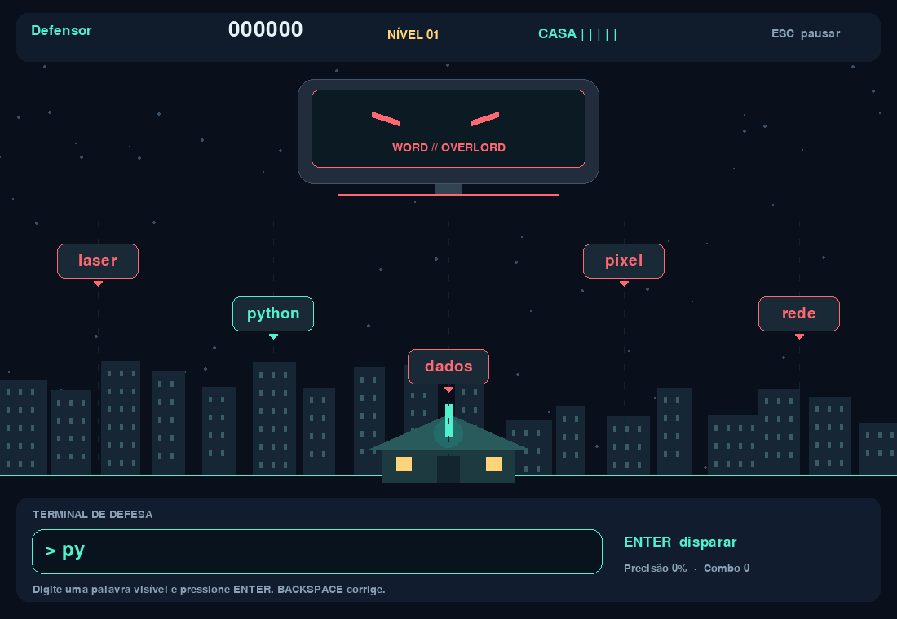

# Words Atack

Um computador gigante está atacando a cidade com palavras digitais. O governo
entrega um canhão laser ao jogador: digite as palavras para defender sua casa.

Prévia acadêmica **0.1.0**, com gráficos provisórios feitos em código.



## Jogar sem instalar Python

No pacote completo, extraia `docs/downloads/WordsAtack-Windows.zip` e abra
`WordsAtack.exe`. Você também recebeu esse ZIP como download separado.
Na versão publicada no GitHub, baixe esse ZIP pela aba **Releases**.
Compatibilidade do pacote: **Windows 64 bits**. Testado neste projeto em
Windows 10, Python 3.14.6 e pygame-ce 2.5.8.

## O que já funciona

- Nickname, menu, história e casa protegida por um canhão laser.
- Cinco corredores de palavras, dificuldade progressiva e efeitos de disparo.
- Pontuação, combos de até x4, precisão, cinco vidas e fim de jogo.
- Pausa por Esc e pausa automática quando a janela perde o foco.
- Ranking SQLite local e fila de envio de partidas ao servidor.
- API Python/Flask + SQLite, com validação e prevenção de partidas duplicadas.
- Site HTML/CSS/JavaScript com download e ranking, preparado para GitHub Pages.
- Script para gerar o executável e workflow de testes e build no GitHub Actions.

## Executar o código-fonte

Recomendado: **Python 3.14**, Git e Windows. Use um terminal na pasta do projeto.

```powershell
python -m venv .venv
.\.venv\Scripts\python.exe -m pip install -r requirements.txt
```

Usamos **pygame-ce**, que fornece `import pygame`. A venv evita conflitos com
outra instalação de Pygame que você já tenha no computador.
Não é necessário ativar a venv; os comandos abaixo chamam seu Python diretamente.

No primeiro terminal, inicie o site e o servidor:

```powershell
.\.venv\Scripts\python.exe run_server.py
```

Abra **http://127.0.0.1:5000** no navegador. Em outro terminal:

```powershell
.\.venv\Scripts\python.exe run_game.py
```

No menu do jogo, pressione **F2**, digite `http://127.0.0.1:5000` e salve com
Enter. Escolha o nickname e jogue. Ao terminar, a partida é salva e enviada.
No site, clique em **Atualizar** no ranking.

Também é possível usar o executável junto com o servidor iniciado pelo código.
O servidor é separado: o executável do jogo não precisa de Flask nem inicia um
servidor automaticamente. Pressione Ctrl+C no terminal para encerrar o servidor.

## Controles e pontuação

| Controle | Ação |
|---|---|
| Digitar + Enter | Destruir uma palavra visível |
| Backspace | Corrigir a entrada |
| Esc | Pausar / continuar / voltar ao menu |
| F2 no menu | Configurar servidor |
| Mouse | Usar os botões |

Palavras sem acentos facilitam o protótipo. Cada letra vale 10 pontos.
O primeiro bloco de cinco acertos vale x1; o seguinte, x2; depois x3 e x4.
Erros e impactos zeram o combo. Um novo nível começa a cada cinco palavras
eliminadas. A precisão é a proporção de disparos corretos entre tentativas
com Enter; corrigir uma letra antes de disparar não reduz a precisão.
Partidas abandonadas não são registradas.

## Estrutura e integração

```text
Words-Atack/
├── game/                   # Regras, interface e SQLite local do jogo
│   ├── main.py
│   ├── settings.py          # Palavras, cores, resolução e constantes
│   └── storage.py           # Configuração e envio em segundo plano
├── server/
│   ├── app.py              # API Flask e site local
│   └── schema.sql          # Tabela e índice do ranking
├── docs/                   # Site publicado no GitHub Pages
│   ├── index.html
│   ├── style.css
│   ├── app.js
│   ├── config.js           # URL da API, download e repositório
│   └── assets/             # Capturas reais e ícone do site
├── data/                   # Banco do servidor criado em execução, ignorado pelo Git
├── scripts/build_windows.py
├── tests/test_project.py
├── .github/workflows/checks.yml
├── dist/                   # Criada ao compilar, ignorada pelo Git
├── GUIA-GITHUB.md           # Publicação do código, download e Pages
├── PERSONALIZACAO.md
├── run_game.py
└── run_server.py
```

```text
Pygame → POST /api/scores → Flask → SQLite
Site   → GET /api/leaderboard → Flask → SQLite
```

O JavaScript recebe JSON e atualiza a tabela. O Python executa as consultas
SQL; o navegador não acessa o banco diretamente. O jogo grava primeiro em seu
banco local e tenta enviar em uma thread. A API usa UUID para reconhecer
reenvios da mesma partida. O ranking do jogo é local; o compartilhado fica no site.

## Dados e configuração

- Jogo: `%LOCALAPPDATA%\WordsAtack\config.json` e `partidas.sqlite3`.
- Servidor: `data/ranking.sqlite3`, criado automaticamente.
- É possível testar com dados separados: `python run_game.py --data-dir pasta`.
- Para outra pasta do banco, configure `WORDS_ATACK_DB` no ambiente do servidor.
- A URL do servidor fica em **F2** no jogo e `docs/config.js` no site.
- Resultados offline são reenviados ao começar/concluir uma partida ou abrir o ranking.
- O ranking ordena pontuação, precisão, menor duração e data. São melhores partidas,
  não uma soma de pontos por jogador. Nicknames podem se repetir.

O arquivo `.env.example` é uma referência; ele não é carregado automaticamente.
Não há contas, senhas ou dados pessoais além do nickname escolhido.

## Testar e gerar outro executável

```powershell
.\.venv\Scripts\python.exe -m pip install -r requirements-dev.txt
.\.venv\Scripts\python.exe -m unittest discover -s tests -v
.\.venv\Scripts\python.exe scripts/build_windows.py
```

Saídas: `dist/WordsAtack.exe` e `dist/WordsAtack-Windows.zip`.
O ZIP inclui instruções e avisos das bibliotecas. A compilação deve ocorrer
no Windows; não produz executável de macOS ou Linux.
Os testes usam vídeo/áudio simulados e dados temporários.

## GitHub Pages e ranking online

Siga **[GUIA-GITHUB.md](GUIA-GITHUB.md)**. Pages publica só o site estático.
O Flask e o SQLite precisam de uma hospedagem com disco persistente para que
o ranking funcione entre computadores. A demonstração local funciona sem isso.

Sem API configurada, o site mostra uma mensagem explícita de ranking não
conectado. Não há pontuações falsas. No pacote local, o download aponta para
um ZIP incluído em `docs/downloads`; antes de publicar, mude para sua Release.

## Limites desta prévia

O ranking é acadêmico: a API valida tipos e limites, mas recebe a pontuação do
cliente e não tem proteção completa contra trapaças, autenticação ou moderação.
Use nicknames públicos. Uma publicação para grande público exigiria proteção
contra abuso e uma política de dados. Não há sons nem sprites externos nesta versão.
O executável não é assinado digitalmente.

## Ensaio de apresentação (3 a 5 minutos)

1. Mostre o repositório e a separação entre jogo, site e servidor.
2. Abra o site e explique HTML, CSS e JavaScript.
3. Inicie o jogo, escolha o nickname e destrua algumas palavras.
4. Deixe a partida terminar e atualize o ranking no site.
5. Mostre `schema.sql` e a consulta do ranking em `server/app.py`.
6. Explique que o executável funciona offline e que o site pode ficar no Pages.

Antes de apresentar, teste o fluxo no computador que será usado e guarde uma
gravação curta da demonstração como reserva.
